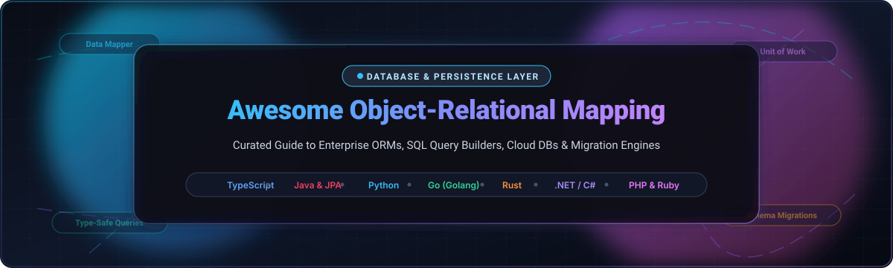

  

# 🗄️ Awesome Object-Relational Mapping (ORM) Tools Ecosystem

  
  
  
  
  
  

---

## 🌟 Top Object-Relational Mapping (ORM) & Database Persistence Ecosystem

> **A curated showcase of premier enterprise SaaS platforms and battle-tested open-source ORMs, SQL query builders, schema migrators, and data mapper engines.**  
> *Architected for Data Mapper Patterns, Unit of Work, Type-Safe Query Building, and Zero-Downtime Schema Evolutions.*  
> **📅 Last updated: March 2026**

This repository tracks notable **SaaS platforms** and **open-source projects** for **Object-Relational Mapping (ORM)**. These tools bridge the gap between object-oriented or functional application code and relational/distributed database engines — mapping database tables to classes, rows to objects, and foreign keys to graph references — while governing transactions, connection pooling, lazy loading, and schema migrations without forcing developers to hand-craft repetitive SQL for standard CRUD workflows.

---

## 📑 Table of Contents

- [📊 Sector Overview & Market Dynamics](#-sector-overview--market-dynamics)
- [☁️ SaaS & Hosted Persistence Platforms](#️-saas--hosted-persistence-platforms)
- [💻 Open-Source GitHub Projects](#-open-source-github-projects)
  - [🏆 Top Ranked Open-Source Libraries (Sorted by Stars)](#-top-ranked-open-source-libraries-sorted-by-stars)
  - [🧩 Architectural Comparison & Implementation Patterns](#-architectural-comparison--implementation-patterns)
- [🤝 How to Contribute](#-how-to-contribute)
- [📈 Star History](#-star-history)
- [💖 Support & Sponsorship](#-support--sponsorship)
- [⚠️ Disclaimer & Tradeoffs](#️-disclaimer--tradeoffs)

---

## 📊 Sector Overview & Market Dynamics

The cloud database and developer data access layer represents an estimated **$120+ Billion global market** by 2026–2028, expanding at a ~16% CAGR driven by serverless computing, edge runtimes, and autonomous AI code generation.

The ORM and query-layer sector remains **moderately fragmented and language-ecosystem partitioned** rather than a winner-take-all monopoly: while mature enterprise ecosystems gravitate toward unified architectural standards (such as **Hibernate/JPA** in Java and **Entity Framework Core** in .NET), modern polyglot environments (TypeScript, Python, Go, Rust, and Elixir) foster vibrant competition between **schema-first, full-abstraction Data Mappers** (like Prisma and MikroORM), **SQL-first type builders** (like Drizzle, jOOQ, and sqlc), and **lightweight micro-ORMs** (like Dapper and Bun).

---

## ☁️ SaaS & Hosted Persistence Platforms

The following SaaS and hosted persistence platforms provide managed connection pooling, change data capture (CDC), serverless scaling, and automated branching workflows tailored directly for modern ORMs and SQL builders.

> *Sorted descending by Company Size (Valuation / Revenue).*

| 🏷️ Platform | 🏢 Company Size (Valuation / Revenue) | 💳 Starting Tier Pricing | 🎁 Free Tier Limit | 🚀 Core Focus & ORM Synergy |
| :--- | :--- | :--- | :--- | :--- |
| **[Supabase](https://supabase.com)** | **$10.5 Billion** valuation *(Series F, ~$170M ARR)* | **$25 / month** *(Pro Plan)* | **Free Forever**: 500 MB database storage, 50,000 monthly active users, 5 GB egress, and up to 2 active projects (pauses after 7 days of inactivity). | Fully managed Postgres with built-in Supavisor connection pooler designed for Prisma, Drizzle, and serverless edge functions. |
| **[Neon](https://neon.tech)** | **$1.0 Billion** valuation *(Acquired by Databricks, ~$25M ARR)* | **$19 / month** *(Launch Plan)* or **$5 / month** minimum usage base | **Free Forever**: 0.5 GB storage, 100 compute hours/month, 10 branch databases, shared CPU (up to 0.25 vCPU). | Serverless Postgres architecture with instant copy-on-write branching for ORM schema migrations and custom WebSocket driver. |
| **[Hasura](https://hasura.io)** | **$1.0 Billion** valuation *(Series C, $100M raised)* | **$99 / month** *(Cloud Standard Tier)* | **Free Forever**: 3 Million monthly API requests, 2 connected database sources, and 100 MB data pass-through. | High-performance instant GraphQL & REST data-mapping engine with granular role-based authorization over relational data. |
| **[PlanetScale](https://planetscale.com)** | **~$560M – $1.0 Billion** valuation *($105M raised)* | **$5 / month** *(PS-5 single node dev tier)* or **$39 / month** *(Scaler Pro)* | **0 Days Free Trial** *(Free hobby tier deprecated; requires entry PS-5 paid plan at $5/month with 1 GB storage & 10M row reads/mo).* | Hyper-scalable Vitess/MySQL database platform featuring non-blocking online schema migrations and database branching. |
| **[Prisma Data Platform](https://www.prisma.io/data-platform)** | **~$350M – $400 Million** valuation *($58.1M raised)* | **$10 / month** *(Starter Plan)* or **$49 / month** *(Pro Plan)* | **Free Forever**: 60,000 queries/month on Accelerate (global connection pooling & edge caching) + 60,000 CDC events/month on Pulse. | Managed edge caching, connection pooling, and real-time database change capture specifically optimized for Prisma ORM. |

---

## 💻 Open-Source GitHub Projects

### 🏆 Top Ranked Open-Source Libraries (Sorted by Stars)

> *All repositories are ranked in descending order according to their verified GitHub star counts. Click the star badge beside any library to inspect its live stargazers community.*

---

#### 1. [Prisma](https://github.com/prisma/prisma) 
* **Language & Ecosystem:** TypeScript / Node.js
* **License:** Apache-2.0
* **Key Features:** **The most downloaded ORM for Node.js and TypeScript** (exceeding 55M monthly npm downloads). Offers a declarative schema-first workflow (`schema.prisma`), generating a fully type-safe query client with IDE autocompletion. Includes **Prisma Migrate** for declarative schema diffing and **Prisma Studio** visual database browser.
* **Trade-offs:** Engine binary can add 100–300ms cold starts in serverless environments (mitigated via Prisma Accelerate); complex SQL operations (window functions, recursive CTEs) require raw SQL fragments.
* **Best For:** Full-stack and backend teams prioritizing exceptional developer experience and end-to-end type safety.

---

#### 2. [GORM](https://github.com/go-gorm/gorm) 
* **Language & Ecosystem:** Go (Golang)
* **License:** MIT
* **Key Features:** The flagship developer-friendly ORM for Golang. Provides comprehensive auto-migrations, deep association handling (`Has One`, `Has Many`, `Belongs To`, `Many To Many`), polymorphic relations, nested transactions, context propagation, and extensible plugins/callbacks.
* **Trade-offs:** Heavy use of reflection can introduce modest runtime overhead compared to compile-time code-generators like `sqlc`.
* **Best For:** Go web applications utilizing frameworks like Gin, Echo, or Fiber desiring Rails-like ergonomic data mapping.

---

#### 3. [TypeORM](https://github.com/typeorm/typeorm) 
* **Language & Ecosystem:** TypeScript / JavaScript
* **License:** MIT
* **Key Features:** Supports both **Data Mapper** and **Active Record** patterns with expressive TypeScript decorators. Multi-database support across PostgreSQL, MySQL, MariaDB, SQLite, SQL Server, Oracle, CockroachDB, and MongoDB.
* **Trade-offs:** Development velocity has slowed relative to modern alternatives; complex decorator setups can become unwieldy; historical issue backlog.
* **Best For:** Maintaining established enterprise TypeScript/NestJS applications with comprehensive decorator architectures.

---

#### 4. [Drizzle ORM](https://github.com/drizzle-team/drizzle-orm) 
* **Language & Ecosystem:** TypeScript / Node.js / Bun / Edge Runtimes
* **License:** Apache-2.0
* **Key Features:** **SQL-native TypeScript ORM with zero binary dependencies** (~7KB bundle). Zero cold start overhead makes it ideal for Vercel Edge, Cloudflare Workers, and AWS Lambda. First-class support for Cloudflare D1, Turso, Neon, and Supabase. Features Drizzle Kit for automated schema migrations and Drizzle Studio.
* **Trade-offs:** Requires developers to be comfortable with relational SQL idioms; rapidly evolving API surfaces.
* **Best For:** Edge computing, serverless architectures, and developers who demand SQL control with uncompromising TypeScript inference.

---

#### 5. [Beego ORM](https://github.com/beego/beego) 
* **Language & Ecosystem:** Go (Golang)
* **License:** Apache-2.0
* **Key Features:** Integrated ORM module within the high-performance Beego Go web framework. Supports pure Go types, automatic table creation, complex query construction, cross-database joins, and raw SQL execution.
* **Trade-offs:** Closely coupled with the Beego framework conventions rather than modular standalone usage.
* **Best For:** Monolithic Go backend services built using the Beego framework suite.

---

#### 6. [Sequelize](https://github.com/sequelize/sequelize) 
* **Language & Ecosystem:** JavaScript / Node.js / TypeScript
* **License:** MIT
* **Key Features:** The veteran Promise-based Node.js ORM with battle-tested maturity. Supports PostgreSQL, MySQL, MariaDB, SQLite, DB2, Snowflake, and MSSQL. Provides solid transaction locking, connection pooling, and optimistic concurrency.
* **Trade-offs:** TypeScript types were retrofitted over time rather than designed TypeScript-first; verbose query API compared to modern alternatives.
* **Best For:** Legacy and existing enterprise Node.js services requiring deep multi-dialect database engine support.

---

#### 7. [MyBatis-3](https://github.com/mybatis/mybatis-3) 
* **Language & Ecosystem:** Java
* **License:** Apache-2.0
* **Key Features:** The definitive SQL-first persistence mapper for Java. Instead of hiding SQL behind an abstraction, MyBatis maps custom SQL queries to Java domain objects via XML or annotations with dynamic SQL templating.
* **Trade-offs:** Requires manual SQL authoring and schema synchronization; no automatic schema generation or migrations built-in.
* **Best For:** Enterprise Java applications demanding complete, direct control over SQL execution and query performance.

---

#### 8. [Knex.js](https://github.com/knex/knex) 
* **Language & Ecosystem:** JavaScript / TypeScript / Node.js
* **License:** MIT
* **Key Features:** The foundational, dialect-flexible SQL query builder for Node.js. Powers higher-level ORMs (such as Objection and Bookshelf). Features connection pooling, stream queries, schema migrations, and seeding CLI tools.
* **Trade-offs:** Lacks full end-to-end static type inference unless paired with auxiliary typing tools; query builder rather than full ORM.
* **Best For:** Teams wanting a lightweight SQL query builder and migration runner without object-mapping overhead.

---

#### 9. [Dapper](https://github.com/DapperLib/Dapper) 
* **Language & Ecosystem:** .NET / C#
* **License:** Apache-2.0
* **Key Features:** The world's fastest open-source micro-ORM for .NET, created by Stack Overflow engineers. Extends `IDbConnection` with ultra-fast extension methods that execute raw SQL and map results directly to POCO classes with performance virtually identical to raw ADO.NET data readers.
* **Trade-offs:** Does not generate SQL, manage change tracking, or handle database migrations automatically.
* **Best For:** High-throughput .NET microservices and APIs where maximum query performance and minimal memory allocations are paramount.

---

#### 10. [sqlc](https://github.com/sqlc-dev/sqlc) 
* **Language & Ecosystem:** Go / Python / Kotlin
* **License:** MIT
* **Key Features:** Compiles raw SQL queries into type-safe, boilerplate-free code. Parses DDL and queries using real database engine parsers, verifying syntax and column types at compile time.
* **Trade-offs:** Dynamic, runtime query construction requires building complex conditional logic or falling back to raw strings.
* **Best For:** Go and polyglot teams who prefer writing pristine SQL while enjoying compile-time verification and zero runtime overhead.

---

#### 11. [ent](https://github.com/ent/ent) 
* **Language & Ecosystem:** Go (Golang)
* **License:** Apache-2.0
* **Key Features:** An entity framework for Go backed by schema-as-code and graph traversal concepts. Schemas are defined as pure Go code, generating fully type-safe graph-traversal APIs, database migrations, and GraphQL integrations via `entgql`.
* **Trade-offs:** Heavy reliance on automated code generation (`go generate`) and a non-standard graph mental model for traditional relational schemas.
* **Best For:** Complex relational domains in Go requiring graph traversal semantics and compile-time type safety.

---

#### 12. [Entity Framework Core](https://github.com/dotnet/efcore) 
* **Language & Ecosystem:** .NET / C#
* **License:** MIT
* **Key Features:** Microsoft's official flagship modern Object-Database Mapper for .NET. Features LINQ (Language Integrated Query), automatic change tracking, robust migrations, shadow properties, global query filters, and split queries.
* **Trade-offs:** Rich feature set introduces significant architectural complexity; improper LINQ query translation can lead to unintended client-side evaluation.
* **Best For:** Modern enterprise .NET and ASP.NET Core applications requiring comprehensive framework integration.

---

#### 13. [Kysely](https://github.com/kysely-org/kysely) 
* **Language & Ecosystem:** TypeScript / Node.js / Bun / Deno
* **License:** MIT
* **Key Features:** A pure, type-safe SQL query builder for TypeScript with zero dependencies and zero runtime generation. Infers return types directly from schema interfaces, providing autocomplete for column names and table joins.
* **Trade-offs:** Query builder focus means it does not handle entity lifecycles, dirty checking, or Unit of Work persistence patterns.
* **Best For:** Developers desiring maximum SQL flexibility with unmatched TypeScript type safety across serverless, edge, and browser runtimes.

---

#### 14. [Diesel](https://github.com/diesel-rs/diesel) 
* **Language & Ecosystem:** Rust
* **License:** MIT / Apache-2.0
* **Key Features:** A safe, extensible ORM and query builder for Rust that prevents runtime database errors at compile time. Generates query code with zero cost abstractions, ensuring queries are completely valid according to your database schema.
* **Trade-offs:** Steep Rust compiler learning curve; synchronous by default (requires threadpool or async adapters for fully async runtimes).
* **Best For:** Rust applications where memory safety, zero-cost performance, and strict compile-time SQL verification are required.

---

#### 15. [SQLAlchemy](https://github.com/sqlalchemy/sqlalchemy) 
* **Language & Ecosystem:** Python
* **License:** MIT
* **Key Features:** The gold-standard Python database toolkit and ORM. Features a dual-layer architecture: the low-level **Core** (relational algebra expression engine) and the high-level **ORM** (Unit of Work and Data Mapper implementation). Pairs with **Alembic** for migrations. Full `asyncio` support in 2.x.
* **Trade-offs:** Significant conceptual overhead and steep learning curve; complex session lifecycles in asynchronous environments.
* **Best For:** Enterprise Python applications, data engineering pipelines, and FastAPI/Flask/Django backends requiring flexible database abstraction.

---

#### 16. [Peewee](https://github.com/coleifer/peewee) 
* **Language & Ecosystem:** Python
* **License:** MIT
* **Key Features:** A lightweight, expressive Python ORM that is simple to learn and intuitive to use. Implements the Active Record pattern with native support for SQLite, MySQL, and PostgreSQL, complete with schema migrations.
* **Trade-offs:** Lacks the enterprise Unit of Work depth and advanced relational abstractions present in SQLAlchemy.
* **Best For:** Python microservices, CLI tools, scripts, and small-to-medium web backends seeking rapid development.

---

#### 17. [Doctrine ORM](https://github.com/doctrine/orm) 
* **Language & Ecosystem:** PHP
* **License:** MIT
* **Key Features:** Enterprise-grade PHP Object-Relational Mapper implementing the strict Data Mapper pattern, decoupling persistence logic from domain entities. The default persistence layer of the Symfony framework.
* **Trade-offs:** Heavyweight memory footprint compared to Active Record patterns; requires strict entity lifecycle management.
* **Best For:** Enterprise PHP applications, domain-driven design (DDD), and Symfony-powered microservices.

---

#### 18. [SeaORM](https://github.com/SeaQL/sea-orm) 
* **Language & Ecosystem:** Rust
* **License:** MIT / Apache-2.0
* **Key Features:** An async, dynamic ORM for Rust built atop `SQLx`. Supports MySQL, Postgres, and SQLite with native async/await, dynamic query building, schema migrations, and code-generation tools.
* **Trade-offs:** Uses dynamic query generation which introduces slight runtime evaluation compared to Diesel's pure compile-time guarantees.
* **Best For:** Asynchronous web services in Rust built with Actix-web, Axum, or Rocket.

---

#### 19. [Exposed](https://github.com/JetBrains/Exposed) 
* **Language & Ecosystem:** Kotlin / JVM
* **License:** Apache-2.0
* **Key Features:** JetBrains' idiomatic Kotlin SQL framework and ORM. Offers two API layers: a lightweight type-safe SQL DSL and a comprehensive DAO (Data Access Object) layer with coroutines support.
* **Trade-offs:** Younger ecosystem than Hibernate/JPA; requires familiarity with idiomatic Kotlin DSL patterns.
* **Best For:** Kotlin server-side applications (Ktor, Spring Boot) seeking idiomatic, non-reflective database interactions.

---

#### 20. [MikroORM](https://github.com/mikro-orm/mikro-orm) 
* **Language & Ecosystem:** TypeScript / JavaScript
* **License:** MIT
* **Key Features:** The only mainstream TypeScript ORM implementing **Unit of Work**, **Identity Map**, and **Data Mapper** together. Automatically batches queries into single atomic transactions, eliminating redundant roundtrips.
* **Trade-offs:** Class instantiation overhead and larger bundle sizes can make it less optimal for cold-start sensitive edge environments.
* **Best For:** Domain-Driven Design (DDD) enterprise architectures where transactional integrity and architectural rigor are paramount.

---

#### 21. [Objection.js](https://github.com/Vincit/objection.js) 
* **Language & Ecosystem:** JavaScript / TypeScript / Node.js
* **License:** MIT
* **Key Features:** SQL-friendly ORM built on top of the Knex.js query builder. Excels at complex relation expressions, JSON schema validation, graph inserts, and eager loading.
* **Trade-offs:** Maintenance velocity has decreased substantially since 2022; not recommended for greenfield deployments.
* **Best For:** Maintaining established Node.js applications with intricate graph relation requirements.

---

#### 22. [jOOQ](https://github.com/jOOQ/jOOQ) 
* **Language & Ecosystem:** Java
* **License:** Apache-2.0 (OSS Edition) / Commercial
* **Key Features:** Generates Java classes directly from database schemas to offer **compile-time checked, fluent SQL**. Strikes the perfect balance between raw SQL control and type safety, handling window functions, lateral joins, and CTEs natively.
* **Trade-offs:** Schema code generation step is mandatory in build pipelines; commercial features required for proprietary databases (Oracle, DB2).
* **Best For:** Java developers seeking total SQL expressiveness without ORM abstraction leaks or runtime SQL syntax bugs.

---

#### 23. [Ecto](https://github.com/elixir-ecto/ecto) 
* **Language & Ecosystem:** Elixir / Erlang BEAM
* **License:** Apache-2.0
* **Key Features:** The flagship database wrapper and query generator for Elixir. Deconstructs traditional ORM responsibilities into clean, composable modules: Schemas, Changesets (data casting & validation), and Repositories.
* **Trade-offs:** Requires adapting to functional programming idioms; tightly integrated with the Elixir ecosystem.
* **Best For:** Highly concurrent, fault-tolerant Phoenix web applications and distributed distributed systems on the BEAM VM.

---

#### 24. [Hibernate ORM](https://github.com/hibernate/hibernate-orm) 
* **Language & Ecosystem:** Java / Jakarta EE
* **License:** LGPL-2.1
* **Key Features:** **The reference implementation of the Jakarta Persistence API (JPA)**. Features mature Data Mapper, Unit of Work, multi-level caching (L1/L2), dirty checking, and complex graph loading. Modernized for Jakarta EE 11 in Hibernate 7.x.
* **Trade-offs:** Steep learning curve; prone to N+1 query traps if fetch plans are poorly configured; heavy abstraction leaks.
* **Best For:** Large-scale enterprise Java monoliths and Spring Boot enterprise applications adhering to JPA standards.

---

#### 25. [Bookshelf.js](https://github.com/bookshelf/bookshelf) 
* **Language & Ecosystem:** JavaScript / Node.js
* **License:** MIT
* **Key Features:** Early JavaScript ORM built on Knex.js featuring both Promise-based and event-driven interfaces with association support.
* **Trade-offs:** Inactive upstream development for over 5 years. Retained strictly for legacy maintenance.
* **Best For:** Legacy Node.js migration targets.

---

#### 26. [Tortoise ORM](https://github.com/tortoise/tortoise-orm) 
* **Language & Ecosystem:** Python
* **License:** Apache-2.0
* **Key Features:** An easy-to-use asyncio ORM for Python inspired by the Django ORM. Built with relations, transactions, and modern `async/await` syntax from day one.
* **Trade-offs:** Smaller community and plugin ecosystem compared to SQLAlchemy.
* **Best For:** Async Python frameworks like FastAPI, Sanic, and Quart where Django-style model syntax is preferred.

---

#### 27. [Waterline](https://github.com/balderdashy/waterline) 
* **Language & Ecosystem:** JavaScript / Node.js
* **License:** MIT
* **Key Features:** Default datastore-agnostic ORM built for the Sails.js MVC framework.
* **Trade-offs:** Inactive upstream commits; monolithic design tied to Sails.js conventions.
* **Best For:** Legacy Sails.js applications.

---

#### 28. [Bun](https://github.com/uptrace/bun) 
* **Language & Ecosystem:** Go (Golang)
* **License:** BSD-2-Clause
* **Key Features:** High-performance, SQL-first Golang client for PostgreSQL, MySQL, MSSQL, and SQLite. Combines query-builder speed with convenient struct mapping, bulk operations, and schema migrations.
* **Trade-offs:** Smaller community footprint than GORM, though offering superior query transparency.
* **Best For:** Go microservices that want SQL-centric control without heavy ORM magic.

---

### 🧩 Architectural Comparison & Implementation Patterns

| Architectural Pattern | Primary Philosophy | Representative Implementations | Core Benefits | Primary Tradeoffs |
| :--- | :--- | :--- | :--- | :--- |
| **Data Mapper** | Separates in-memory domain entities from database persistence logic. | **Hibernate**, **MikroORM**, **SQLAlchemy ORM**, **Doctrine** | Clean domain isolation; entities remain pure without persistence code. | Complex configuration, higher abstraction curve. |
| **Active Record** | Each entity class represents a database table; entity instances handle their own CRUD. | **TypeORM** (ActiveRecord mode), **GORM**, **Peewee**, **Rails Active Record** | Rapid prototyping, highly intuitive API for simple CRUD operations. | Tight coupling between business logic and database schema; hard to unit test. |
| **SQL-First / Code Generator** | Write standard SQL; tool compiles queries into verified, type-safe application code. | **sqlc**, **jOOQ**, **MyBatis** | Zero abstraction leaks, complete SQL control, optimal runtime efficiency. | Dynamic query building is harder; schema code generation required in CI/CD. |
| **Type-Safe Query Builder** | Write SQL-like DSL in native language; types verified at compile time. | **Drizzle ORM**, **Kysely**, **Diesel** | Maximum TypeScript/Rust type inference; near-zero runtime overhead. | Lacks automated change tracking and identity maps; queries written manually. |

---

## 🤝 How to Contribute

Contributions are warmly welcomed! To contribute:

1. **Fork the repository** to your GitHub account.
2. **Add or refine an entry** in `README.md` keeping formatting consistent.
3. **Include details**: Name, star badge link (``), language ecosystem, key strengths, trade-offs, and target use cases.
4. **Submit a Pull Request** with a concise description of your additions.

---

## 📈 Star History

---

## 💖 Support & Sponsorship

If this curated guide helps you architect your persistence layer, choose the right ORM, or avoid costly performance bottlenecks:

* ⭐ **Star this repository** to help other developers discover it!
* 🍴 **Fork and share** with your backend engineering team.
* ☕ **Sponsor or buy a coffee** to fuel continuous updates: **[Support via GitHub Sponsors Dashboard](https://github.com/sponsors/ishandutta2007)**

Your sponsorship directly supports ongoing maintenance, community PR reviews, and research into next-generation database infrastructure.

---

## ⚠️ Disclaimer & Tradeoffs

* **Community-Curated**: This guide is maintained by backend developers and community contributors — it is not an endorsement of any commercial platform.
* **Cold Starts & Serverless**: Heavy binary query engines (e.g., Prisma engine) introduce 100–300ms latency on Lambda cold starts unless offloaded through connection pooling proxies (Prisma Accelerate, Supavisor). Zero-dependency SQL builders (Drizzle, Kysely) avoid binary cold start delays entirely.
* **The N+1 Query Dilemma**: High-level ORMs with lazy loading will trigger disastrous N+1 query spirals in production unless proper eager fetching (`JOIN FETCH`, split queries, or data loaders) is explicitly planned.
* **Abandoned Libraries**: Several historical Node.js libraries (Bookshelf.js, Waterline, Objection.js) have ceased active updates — do not adopt these for greenfield 2026+ deployments.

---

  <b>Crafted for backend engineers, database architects, and teams building resilient, type-safe data architectures.</b> 
  Let's make database persistence fast, transparent, and rock-solid.

